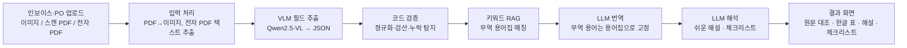

# TradePilot

**VLM·LLM 기반 무역문서 분석 및 지능형 업무지원 서비스**
*An on-premise AI assistant that turns English trade documents (invoices, purchase orders) into plain-Korean explanations and department-level action checklists.*

> 영문 인보이스·발주서(PO)를 한 번 업로드하면, 핵심 거래정보를 한글 표로 정리하고 금액을 자동 검산한 뒤,
> 무역 비전문가도 이해할 수 있는 쉬운 해설과 부서별 후속 업무 체크리스트를 만들어 주는 온프레미스 AI 서비스입니다.


-green)

---

## 목차
1. [왜 만드나요](#1-왜-만드나요)
2. [무엇을 하나요](#2-무엇을-하나요)
3. [어떻게 동작하나요](#3-어떻게-동작하나요)
4. [팀원별 역할과 작업 내용](#4-팀원별-역할과-작업-내용)
5. [기술 스택](#5-기술-스택)
6. [저장소 구조](#6-저장소-구조)
7. [일정과 마일스톤](#7-일정과-마일스톤)
8. [성공 기준](#8-성공-기준)
9. [데이터·모델 출처와 라이선스](#9-데이터모델-출처와-라이선스)
10. [협업 규칙](#10-협업-규칙)

---

## 1. 왜 만드나요

무역 전담 인력이 없는 국내 중소기업 실무자는 해외 거래처의 영문 인보이스·발주서를 받으면 세 단계에서 막힙니다.

| 병목 | 내용 |
| --- | --- |
| ① 정보 탐색 | 거래처마다 양식·항목 이름·배치가 달라 필요한 거래정보를 찾는 데 시간이 걸린다 |
| ② 용어 해석 | Incoterms, Payment Terms 같은 전문용어와 축약된 거래조건을 따로 검색·번역해야 한다 |
| ③ 후속 업무 정리 | 결제·구매·생산·물류 부서가 확인할 일을 다시 정리해야 하고, 전달 과정에서 오기입·누락이 생긴다 |

**근거**
- ICT 중소기업의 해외진출 애로 중 "무역 전문 인력 부족"은 2017년 15.9%에서 2022년 29.2%로 늘어 2위가 되었다 (과학기술정보통신부, 「ICT중소기업실태조사」, KOSIS).
- 수출입신고서를 정정하면 오류점수가 누적되어 P/L(무서류) 신고 정지, 검사비율 상향 등의 제재를 받는다 (관세청, 「수출입신고 오류방지에 관한 고시」). 원본 거래 문서 단계에서 정확히 읽고 검산하는 것이 중요하다.
- 인보이스·PO에는 거래처·단가·계좌 같은 영업 기밀이 들어 있어, 외부 클라우드 API 없이 사내에서 처리할 필요가 있다.

## 2. 무엇을 하나요

| ID | Must 기능 | 완료 기준 |
| --- | --- | --- |
| FR-01 | 문서 업로드 및 핵심 필드 추출 | 지정된 JSON 스키마 파싱 오류 0건 |
| FR-02 | 데이터 검증 (품목 금액 합산 ↔ 문서 총액 검산) | 추출 수치의 계산 오류 탐지 |
| FR-03 | 한글 번역 및 거래정보 구조화 | 당사자·품목·총액·결제 조건·마감일·배송이 한글 결과에 누락 없이 매핑 |
| FR-04 | 쉬운 업무 해설 및 부서별 체크리스트 | 당사자·금액 흐름·결제 방법·기한이 들어간 해설 + 부서별 체크리스트 |

**결과 화면에 나오는 해설 예시**
> 영국의 자전거 회사 Atlas Cycles가 독일의 자전거 판매점 Global Bike Retailers에게 여행용 자전거 11대와 조끼·장갑·차량용 자전거 거치대·페달을 팔고 보낸 청구서입니다. 물건값은 원래 12,814.65파운드인데 일부 품목에 2% 할인이 들어가 12,571.64파운드가 되었고, 여기에 운송비 1,902.10파운드와 세금 1,218.19파운드를 더해 총 15,691.93파운드를 내야 합니다. 이 금액을 2024년 10월 21일까지 문서 왼쪽 아래에 적힌 영국 은행 계좌로 계좌이체하면 됩니다.

**제외 범위**: 통관·관세 신고 자동화, ERP·회계 시스템 연동, 영어 외 문서, 모델 파인튜닝

## 3. 어떻게 동작하나요



**설계 원칙**
- **숫자는 코드가 책임진다.** 금액·날짜·수량은 LLM이 만들지 않고, 검증된 JSON 값을 그대로 넣는다.
- **용어는 용어집이 책임진다.** 영문 무역 용어집의 키워드로 문서 표현을 찾아(키워드 기반 RAG) 용어를 고정한다. 같은 영문 용어는 어느 문서에서든 같은 한국어로 나온다.
- **LLM은 문장을 책임진다.** 같은 로컬 LLM을 두 번 호출해 ① 텍스트 칸을 자연스러운 한국어로 번역하고(용어는 자리표시로 고정했다가 용어집 번역으로 복원) ② 쉬운 해설과 체크리스트를 쓴다. 용어집에 없는 표현은 직역하고 "용어집 미등록"으로 표시한다.
- **외부로 나가지 않는다.** 모든 모델은 로컬 GPU에서 실행한다.

**사전 테스트 결과** (Qwen2.5-VL-7B, RTX 4090, 평가셋 송장 50건·발주서 50건)

| 입력 방식 | 송장 정확도 | 발주서 정확도 | 문서당 시간 |
| --- | --- | --- | --- |
| 스캔 이미지 | 98.8% | 91.6% | 약 9~12초 |
| PDF 이미지 | 98.7% | 88.7% | 약 9~12초 |
| PDF 이미지 + 텍스트 힌트 | **99.7%** | **93.1%** | 약 9~12초 |

## 4. 팀원별 역할과 작업 내용

**팀명: Eye2Text** · PM: 한병준

| 이름 | 역할 | 한 줄 요약 |
| --- | --- | --- |
| **김종호** | Vision · Data | 문서를 "읽는" 부분: 데이터셋을 만들고 VLM으로 문서에서 정확한 JSON을 뽑아낸다 |
| **이규남** | LLM · Backend | 문서를 "설명하는" 부분: 검증 엔진과 키워드 기반 RAG(한병준 님과 공동), LLM 번역·해석으로 한글 표와 쉬운 해설·체크리스트를 만들고 API로 제공한다 |
| **한병준** | LLM · Frontend · PM | 문서를 "보여주는" 부분: 업로드부터 결과 확인까지 사용자 화면을 만들고 프로젝트 일정을 관리한다 |

### 김종호 — Vision · Data

**작업 폴더**: [`members/jongho/`](members/jongho/)

**맡은 일**: 공개·합성 인보이스 데이터셋 구축, Qwen2.5-VL 기반 JSON 파싱과 필드 추출 정확도 검증

| WBS | 작업 | 기간 | 완료 기준 |
| --- | --- | --- | --- |
| W-01 | 데이터 확보·구조 점검 | 11.30 | 평가셋(송장·발주서 각 50건) 수량·형식 확인, 데이터 명세 초안 |
| W-02 | JSON 스키마·입출력 계약 확정 (주 담당) | 12.01~12.03 | 공통 + 송장 + 발주서 + 무역 블록 스키마 동결 |
| W-03 | 합성 무역 문서·오류 문서 생성 | 12.04 | Incoterms·HS 코드 등이 들어간 합성 문서, 금액 오류 주입 문서 20건 |
| W-04 | VLM 기준선 실행 | 12.04 | 고정 테스트셋 필드 F1과 실패 사례 기록 |
| W-05 | VLM 개선 실험 | 12.07~12.08 | 프롬프트 개선, 전자 PDF 텍스트 힌트, 양자화 비교 → 최종 설정 |
| W-12 | 테스트·평가·문서화 (주 담당) | 12.14 | 성공 기준 지표 측정, 평가 결과 정리 |

**산출물**: 데이터 명세, 평가셋·합성 문서, VLM 추출 모듈(`backend/src/extraction.py`), 평가 스크립트, 평가 결과 보고
**검토 담당**: 이규남 님의 검증 엔진·백엔드 API

### 이규남 — LLM · Backend

**작업 폴더**: [`members/knlee/`](members/knlee/)

**맡은 일**: 무역 용어 프롬프트, LLM 기반 쉬운 해설·업무 체크리스트 생성, FastAPI 백엔드 구축

| WBS | 작업 | 기간 | 완료 기준 |
| --- | --- | --- | --- |
| W-06 | 정규화·검증 엔진 | 12.04~12.07 | 날짜·금액 정규화, 품목·세금·총액 검산, 누락 탐지, "확인 필요" 플래그 |
| W-08 | LLM 번역·해석 생성 | 12.07~12.09 | 텍스트 칸 번역(용어 고정·번역 후 검사), 해설·체크리스트, 번역 비교 실험(LLM 단독 vs 용어집 고정), LLM 후보 2종(EXAONE-3.5 / A.X 4.0 Light) 비교 후 최종 모델 결정 |
| W-09 | 백엔드 API (FastAPI) | 12.09~12.10 | 업로드 → 결과 JSON 반환 엔드포인트, 모델 로딩 관리 |
| W-07 | 키워드 기반 RAG 구축 (공동) | 12.04~12.08 | 키워드 매칭 엔진(단어 경계·필드 구분), 미등록 용어 처리, 키워드 적중률 측정 |

**산출물**: 검증 모듈(`validation.py`), 검색 모듈(`retrieval.py`), 생성 모듈(`generation.py`), 프롬프트(`backend/prompts/`), FastAPI 서버, README 실행 안내
**검토 담당**: 김종호 님의 VLM 개선 실험, 한병준 님의 프런트엔드

### 한병준 — LLM · Frontend · PM

**작업 폴더**: [`members/hbj/`](members/hbj/)

**맡은 일**: 문서 업로드 UI, 원문-해설 대조 뷰어, 부서별 체크리스트 화면 구현, 프로젝트 일정·범위 관리

| WBS | 작업 | 기간 | 완료 기준 |
| --- | --- | --- | --- |
| W-07 | 키워드 기반 RAG 구축 (공동) | 12.04~12.08 | 팀 보유 영문 무역 용어집을 YAML로 변환·중복 정리, 문서 종류 안내, 대응 규칙, 해설 모범 예시 |
| W-10 | 프런트엔드 UI (React) | 12.04~12.10 | 업로드·원문 대조·체크리스트·오류 안내 화면 (목업 JSON으로 먼저 개발) |
| W-11 | 통합·E2E 실행 (주 담당) | 12.10~12.11 | 대표 데모 시나리오 3건을 처음부터 끝까지 실행 (통합 MVP) |
| PM | 일정·범위·회의·통합 의사결정 | 전 기간 | 계획서, 변경 기록, 발표 흐름 |

**산출물**: React 프런트엔드(`frontend/`), 무역 용어집(`knowledge/`), 통합 MVP, 발표 자료
**검토 담당**: 이규남 님의 해설·체크리스트 생성

### 함께 하는 일
- **W-02 JSON 스키마 확정**: 세 파트를 잇는 계약이라 전원이 함께 결정합니다.
- **교차 검토**: 모든 작업에 주 담당 1명과 검토자 1명을 둡니다. 특정 팀원만 구조를 아는 상황을 피합니다.
- **결과물 제작 (12.15~12.16)**: 결과보고서, 발표자료, 시연 영상

## 5. 기술 스택

| 영역 | 사용 기술 |
| --- | --- |
| Vision (문서 인식) | Qwen2.5-VL-7B-Instruct (비교 후보: InternVL3-8B) |
| LLM (해설 생성) | EXAONE-3.5-7.8B-Instruct / A.X 4.0 Light (비교 평가 후 결정) |
| RAG | 키워드 기반 RAG (영문 무역 용어집 YAML 매칭). 벡터 검색(bge-m3)은 키워드 적중률이 부족할 때만 추가 |
| 문서 처리 | pdfplumber, pypdfium2 |
| Backend | Python, FastAPI, PyTorch, Hugging Face Transformers |
| Frontend | React (Vite) |
| 실행 환경 | 로컬 GPU 서버 RTX 4090 (24 GB), 외부 API 없음 |

## 6. 저장소 구조

```
TradePilot/
├─ backend/                FastAPI 서버와 AI 파이프라인
│  ├─ src/                 입력 처리 · VLM 추출 · 검증 · 검색 · 생성 · 평가 모듈
│  └─ prompts/             VLM·LLM 프롬프트 (버전 관리)
├─ frontend/               React 화면 (업로드 · 결과 대조 · 체크리스트)
├─ knowledge/              영문 무역 용어집 · 대응 규칙 · 해설 예시 (YAML)
├─ schemas/                추출 JSON 스키마 (공통 · 송장 · 발주서)
├─ data/                   데이터 안내 (실제 데이터는 Git에 올리지 않음)
├─ tools/                  데이터 내려받기·정제 스크립트
├─ tests/                  테스트 코드
├─ docs/                   기획서 · 계획서 · 설계서 (docs/README.md)
├─ members/                팀원별 실험 공간
│  ├─ jongho/            김종호
│  ├─ knlee/             이규남
│  └─ hbj/               한병준
├─ .env.example            환경 변수 예시
└─ README.md
```

- 실험·시도는 `members/<본인>/`에서 자유롭게 하고, 검증된 코드만 `backend/`, `frontend/`로 옮깁니다.
- 데이터셋과 모델 가중치는 용량 때문에 Git에 올리지 않습니다.

### 데이터 받기

| 데이터 | 용량 | 명령 |
| --- | --- | --- |
| 평가셋 (송장 50 + 발주서 50) | 약 34 MB | `python tools/download_data.py` |
| 정제 데이터셋 (영문 5종 전체) | 약 9 GB | `pip install -r tools/dataset_prep/requirements.txt` → `python tools/dataset_prep/prepare_dataset.py` |

대부분의 작업은 평가셋만으로 충분합니다. 자세한 내용은 [`data/README.md`](data/README.md)를 참고하세요.

## 7. 일정과 마일스톤

| 기간 | 단계 | 마일스톤 |
| --- | --- | --- |
| 11.23 ~ 11.26 | 문제 분석 · 기획 | 기획보고서 확정 |
| 11.30 ~ 12.03 | 계획 · 설계 | **12.03 계획서·설계서 v1.0 동결** |
| 12.04 ~ 12.09 | 개발 · 기준선 | 12.04 데이터 v1·기준선, 12.09 최종 모델 확정 |
| 12.10 ~ 12.11 | 통합 | **12.11 통합 MVP** |
| 12.14 | 검증 · 보완 | 12.14 테스트 완료 |
| 12.15 ~ 12.16 | 결과물 제작 | 보고서 · 발표자료 · 시연 영상 |
| 12.17 | 발표 | **최종 발표** |

## 8. 성공 기준

| 구분 | 지표 | 목표 | 측정 방법 |
| --- | --- | --- | --- |
| 모델 품질 | 핵심 필드 추출 F1 | 90% 이상 | 송장·발주서 각 15건, 정답 JSON 비교 |
| 검증 정확도 | 금액 오류 탐지율 | 90% 이상 | 정상·오류 문서 20건 |
| 업무지원 품질 | 핵심 정보 반영·체크리스트 적절성 | 85% 이상 | 문서별 필수 항목 체크리스트 검수 |
| 응답 성능 | 전체 처리 시간 | 30초 이내 | RTX 4090, 단일 페이지 문서 |

## 9. 데이터·모델 출처와 라이선스

| 구분 | 출처 | 라이선스 |
| --- | --- | --- |
| 평가용 문서 | [AyoubChLin/Company-document-dataset-v2](https://huggingface.co/datasets/AyoubChLin/Company-document-dataset-v2) (합성 비즈니스 문서) | Apache-2.0 |
| Vision 모델 | [Qwen/Qwen2.5-VL-7B-Instruct](https://huggingface.co/Qwen/Qwen2.5-VL-7B-Instruct) | Apache-2.0 |
| LLM 후보 | [LGAI-EXAONE/EXAONE-3.5-7.8B-Instruct](https://huggingface.co/LGAI-EXAONE/EXAONE-3.5-7.8B-Instruct) | EXAONE AI Model License (비상업) |
| LLM 후보 | A.X 4.0 Light (SK Telecom) | Apache-2.0 |
| 임베딩 (선택) | [BAAI/bge-m3](https://huggingface.co/BAAI/bge-m3) | MIT |

- 개발과 평가에는 공개 합성 데이터만 사용하며, 실제 기업 문서는 포함하지 않습니다.
- 이 저장소는 AI캠퍼스 교육 과정의 비상업 프로젝트입니다. EXAONE 모델은 라이선스에 따라 비상업 목적으로만 사용합니다.

## 10. 협업 규칙

- **작업 범위**: 각자 `members/<본인>/` 폴더에서 작업한 것만 커밋합니다. `backend/`, `frontend/`, `schemas/` 같은 공통 폴더를 바꿀 때는 팀과 합의한 뒤 반영합니다.
- **서버 사용**: 팀 GPU 서버에서는 `git pull`로 받아 실행만 하고, 커밋·푸시는 각자 PC에서 합니다. 실행 결과(`results/`, `logs/`)는 git에서 제외됩니다.
- **브랜치**: `main`은 항상 실행 가능한 상태로 유지합니다. 작업은 `feat/<작업>` 또는 `<이름>/<작업>` 브랜치에서 하고 Pull Request로 합칩니다.
- **커밋 메시지**: `[W-05] PO 프롬프트에 납품처 항목 추가`처럼 WBS ID를 앞에 붙입니다.
- **비밀 정보**: 서버 주소, 계정, 토큰은 `.env`에만 두고 커밋하지 않습니다. `.env.example`에 키 이름만 적습니다.
- **대용량 파일**: 데이터·모델·결과 이미지(100 MB 초과)는 올리지 않습니다.
- **줄바꿈**: 모든 텍스트 파일은 LF로 저장합니다 (`.gitattributes`로 자동 적용).

---

<sub>AI캠퍼스 프로젝트 · Team Eye2Text (김종호 · 이규남 · 한병준) · 2026</sub>
